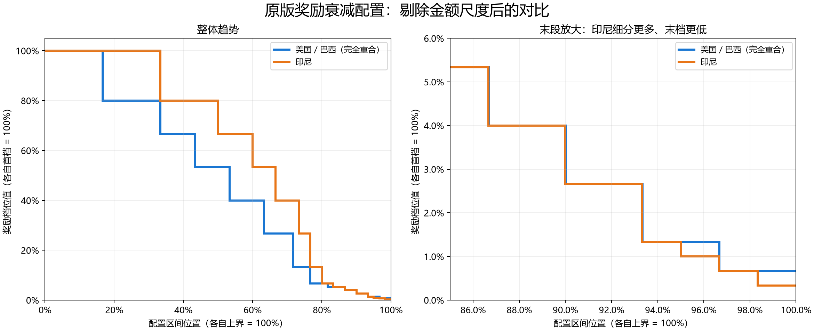

# 美国、巴西、印尼奖励趋势对比

结论：美国与巴西的完整解密规则完全相同；印尼采用相似的阶梯衰减方向，但不是同一张区间表按统一比例放大。

## 比较方法

横轴用各表最后一个 `lh` 归一化，纵轴用各表第一个 `value` 归一化。这样同时去掉区间金额尺度与奖励金额尺度。横轴表示配置区间位置，不是关卡进度、耗时或已证实的提现完成度。采用实际表上界（299.99 / 299998），不假定它就是提现门槛。

| 指标 | 美国 / 巴西 | 印尼 |
|---|---:|---:|
| 档数 | 13 | 15 |
| 首次下降位置 | 16.67% | 33.33% |
| 奖励首次降至首档的 50% 或以下 | 53.34% | 66.67% |
| 奖励首次降至首档的 10% 或以下 | 76.67% | 80.00% |
| 奖励首次降至首档的 1% 或以下 | 96.67% | 95.00% |
| 最后一档相对首档 | 0.67% | 0.33% |

## 区间判断

- 美国与巴西：13 档的起点、终点、档位值，以及倍率和浮动区间全部相同。
- 印尼：前 12 档奖励值除以 1000 后，与美国/巴西前 12 档值依次相同，但这些档位覆盖的区间并不相同。例如首档终点比例约为 33.33%，美国/巴西约为 16.67%。
- 中后段局部相同：将印尼横轴和奖励值均除以 1000 后，[260,270)、[270,280) 两段与美国/巴西完全一致。这种局部重合不足以证明整表相同。
- 末段不同：美国/巴西在归一化约 96.67% 后维持首档的 0.667%；印尼增加了中间档，并在约 98.33% 后降到首档的 0.333%。印尼不是全程奖励更高，而是前段衰减较晚、末段更低。
- 三者视频倍率均为 10，浮动区间均为 0.8–1.2；这部分机制相同。

## 证据范围

这是已收到的衰减配置趋势比较，不是实际逐关到账曲线。美国来自之前原账号采集，巴西有两个一致的新身份完整样本，印尼有一个完整新身份样本；样本阶段并非完全相同。由此可以判断这些配置表是否同形，不能据此证明全部用户都遵循同一配置或推算通关次数/提现耗时。第二个印尼样本奖励配置不完整，未纳入。

源文件、归一化全表及指标见 [trend-results.json](trend-results.json)。
